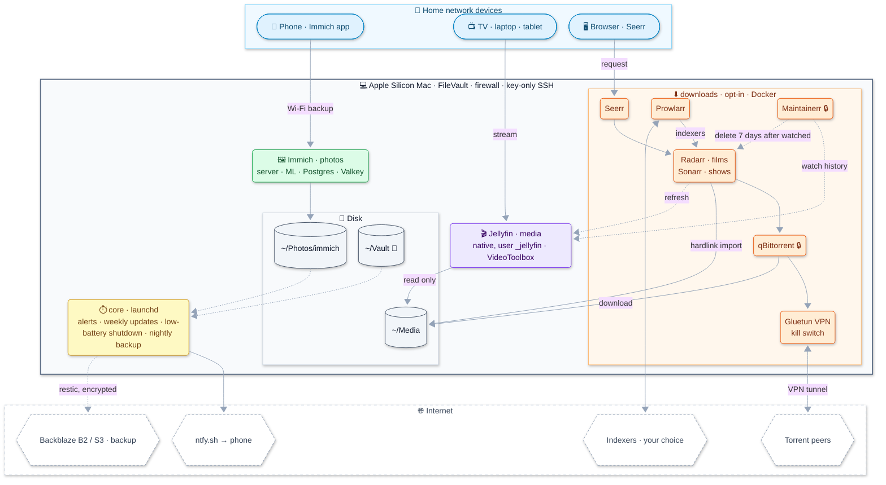

# HomeCider

**Turn any Mac into a private home server.** HomeCider sets up films, shows and photo backup with three
commands and a short checklist, and keeps everything on your home network.

[](https://github.com/NipunaRanasinghe/homecider/actions/workflows/shellcheck.yml)
[](LICENSE)


```sh
git clone https://github.com/NipunaRanasinghe/homecider.git ~/homecider && cd ~/homecider
bin/homecider init && bin/homecider doctor && bin/homecider apply
```

Read [Before you install](#before-you-install) first: `apply` changes settings for the whole Mac.

> [!NOTE]
> Early development (0.1.0-dev). Tested on a MacBook Air M1 with the current macOS.
> Other Apple Silicon Macs should work; reports are welcome.

**Contents:** [What you get](#what-you-get) · [Before you install](#before-you-install) ·
[Requirements](#requirements) · [Install](#install) · [Everyday use](#everyday-use) ·
[How it fits together](#how-it-fits-together) · [Why macOS](#why-macos-and-not-linux) ·
[What `apply` changes](#what-apply-changes-on-your-mac) · [Uninstall](#uninstall) ·
[Contributing](#contributing) · [License](#license)

## What you get

| Module | What it does | Default |
|---|---|---|
| `core` | Key-only SSH, no sleep (lid closed too), firewall and stealth mode, sharing services off, macOS updates download-only, push alerts (disk, battery, services, updates), weekly app and container updates, clean shutdown on low battery (laptops) | always on |
| `media` | [Jellyfin](https://jellyfin.org) running natively with Apple VideoToolbox hardware transcoding, as a hidden user that can read only your media folder | on |
| `photos` | [Immich](https://immich.app) photo and video backup from your phone, pinned version | on |
| `backup` | Nightly encrypted [restic](https://restic.net) backup to Backblaze B2 or any S3 bucket, 30-day deletion protection, restore test, alert when stale. See [docs/backup.md](docs/backup.md) | off (needs a bucket) |
| `downloads` | Request and library management (Seerr, Radarr, Sonarr, Prowlarr, qBittorrent, Maintainerr) with 1080p quality profiles. VPN-only unless you opt in to your home connection. See [docs/downloads.md](docs/downloads.md) | **off** |

Nothing is exposed to the internet: no port forwards, no UPnP, and admin-only tools listen on localhost.

## Before you install

Works on Apple Silicon Macs (M1 or later): MacBook (lid closed), Mac mini, iMac or Mac Studio. Intel Macs are
not supported: Apple no longer releases new macOS versions for them, and HomeCider is tested only on Apple Silicon.

Use a Mac that stays at home and stays on. A dedicated one is best, because HomeCider changes settings for the
whole Mac: it disables sleep (also with the lid closed), turns off File Sharing and Screen Sharing, makes your
home folder private to other accounts, upgrades its own Homebrew apps every week, and on laptops shuts the Mac down
at 15% battery (`BATTERY_SHUTDOWN_PCT`). Every setting and its default is in `homecider.env.example`.
The full list of system changes is in [What `apply` changes on your Mac](#what-apply-changes-on-your-mac).

> [!WARNING]
> **After a restart or power cut, everything stays down until someone unlocks the Mac in person.** With
> FileVault on (recommended), macOS waits at the unlock screen before any service or SSH starts. Laptops ride
> out short power cuts on battery; desktops restart only when power returns and still need the unlock.

## Requirements

- Apple Silicon Mac (M1 or later), current or previous macOS release
- [Homebrew](https://brew.sh)
- Remote Login (SSH) on, with your SSH public key in `~/.ssh/authorized_keys`. **`apply` turns off SSH password
  login**, so add the key first.
- FileVault on (recommended). After every restart the Mac must be unlocked in person before services start.

## Install

On the Mac that will be the server:

```sh
git clone https://github.com/NipunaRanasinghe/homecider.git ~/homecider
cd ~/homecider
bin/homecider init      # writes ~/.config/homecider/homecider.env; review MODULES and paths
bin/homecider doctor    # checks prerequisites
bin/homecider apply     # sets everything up; asks for your password once for system changes
```

`apply` is safe to re-run: after changing `homecider.env`, after `git pull`, or to repair a setting.

Then, once:

1. Install the [ntfy](https://ntfy.sh) app on your phone and subscribe to the topic `apply` printed.
2. Open Jellyfin at `http://<mac>:8096` and Immich at `http://<mac>:2283` **right away** and create the admin
   accounts. The first visitor becomes admin.
3. Jellyfin: Dashboard → Playback → Transcoding → Hardware acceleration: **Apple VideoToolbox**.
4. Laptops: set a charge limit (System Settings → Battery), so the battery is not held at 100% all the time.

## Everyday use

```sh
bin/homecider status    # services, jobs, containers, disk, battery, active alerts
bin/homecider apply     # after editing homecider.env or pulling a new version
```

- **Alerts** arrive on your phone when the disk is above 85% (`DISK_ALERT_PCT`), the Mac runs on battery,
  Jellyfin or Immich is down for 10 minutes, a container stops, the last backup is more than 36 hours old, or a
  macOS update is waiting.
  Alerts go through the public [ntfy.sh](https://ntfy.sh) server: the message text (e.g. "Disk 91% full",
  "Jellyfin is down") passes through it, and anyone who knows your topic name can read your alerts. The topic is
  random (`hc-` plus 24 hex characters); keep it private, or set `NTFY_SERVER` to your own ntfy server.
- **Vaults** for archives you rarely open (old phone backups, documents): `bin/homecider vault create NAME` makes an
  AES-256 encrypted disk image in `~/Vault`; while closed it is unreadable, even to programs running as you.
  The `backup` module backs vaults up as they are, still encrypted.
- **Updates**: HomeCider's Homebrew apps (OrbStack, Jellyfin, restic) and container images update every Sunday at
  04:00 (`UPDATE_WEEKDAY`, `UPDATE_HOUR`). Set `UPDATE_ALL_HOMEBREW=true` to upgrade every Homebrew app.
  After the update, dangling Docker images (untagged, unused) are removed; `UPDATE_PRUNE_IMAGES=false` keeps them.
  Immich is pinned; you get a message when a new release exists. macOS updates download automatically and wait
  for you, because each one restarts into the FileVault unlock screen.

## How it fits together



🔒 listens on 127.0.0.1 only (SSH tunnel) · 🔐 encrypted disk image, closed when not in use ·
solid arrows: requests and data · dotted arrows: automatic background actions.
Without a VPN configured, qBittorrent sends nothing; the home connection is an explicit opt-in.

## Why macOS and not Linux

- **Hardware transcoding.** Jellyfin uses VideoToolbox on Apple Silicon; Linux on these Macs has no hardware
  video encoder.
- **Battery as a UPS.** On a MacBook, power cuts are covered by the battery, with an alert and a clean shutdown.
- **FileVault.** The whole disk is encrypted when the Mac is off or stolen.

Containers run in [OrbStack](https://orbstack.dev), which uses less memory and CPU than Docker Desktop.
Jellyfin runs outside Docker because containers on macOS cannot use VideoToolbox.

## What `apply` changes on your Mac

So you can review it before running:

- `/etc/ssh/sshd_config.d/000-homecider.conf`: password and keyboard-interactive login off, root login off,
  only your user allowed.
- `pmset`: sleep off (also with the lid closed), wake on network.
- Application firewall on with stealth mode; File Sharing, Screen Sharing and Remote Apple Events off.
- Software Update: automatic check and download; no automatic install.
- LaunchAgents `io.homecider.alerts` and `io.homecider.update`; on laptops, LaunchDaemon `io.homecider.low-battery`.
- `media`: hidden user `_jellyfin` (UID 450), LaunchDaemon `io.homecider.jellyfin`, data in
  `/Library/Application Support/jellyfin`, a sudoers rule that lets you restart Jellyfin without a password.
  Your home folder becomes `750` and other home folders readable by other users become private.
- With `photos` or `downloads` on: a `PATH` line for OrbStack's `docker` in `~/.zshenv`, the compose and buildx
  plugins linked into `~/.docker/cli-plugins/`, OrbStack set to start at login with a memory cap
  (`DOCKER_MEMORY_MIB`).
- Your settings in `~/.config/homecider/homecider.env`. Secrets (ntfy topic, database and app passwords) in
  `~/Library/Application Support/homecider/secrets.env` (mode 600), generated Compose settings in
  `~/Library/Application Support/homecider/compose/`. Nothing is written into the code folder.

## Uninstall

```sh
bin/homecider uninstall
```

Stops the containers, removes the launchd jobs, the SSH config file, the sudoers rule and the `_jellyfin` user,
and resets `pmset` to the macOS defaults (sleep on). SSH password login is allowed again.

- **Kept**: media, photos, app data, Jellyfin data, vaults, `homecider.env`, `secrets.env`, the backup repository
  and the Homebrew apps (`brew uninstall --cask orbstack jellyfin` removes them).
- **Not changed back**: firewall and stealth mode, sharing services (off), the macOS update policy and
  home-folder permissions. HomeCider does not record their values before `apply`; change them in System Settings.

## Contributing

See [CONTRIBUTING.md](CONTRIBUTING.md).

## Repository layout

```
bin/homecider          the command
lib/common.sh          config loading, defaults, helpers
modules/<name>/        root.sh (runs with sudo) and/or user.sh, plus the module's files
homecider.env.example  every setting, with defaults
docs/                  design decisions and module guides
```

## Third-party components

HomeCider installs and configures software from other projects; each keeps its own license.
`modules/photos/docker-compose.yml` and `example.env` are Immich's official files (AGPL-3.0), unmodified.
Container images belong to their projects (Immich, LinuxServer.io, Seerr, Maintainerr, Recyclarr).
Quality profiles come from [TRaSH Guides](https://trash-guides.info) via Recyclarr.

## License

[MIT](LICENSE)
