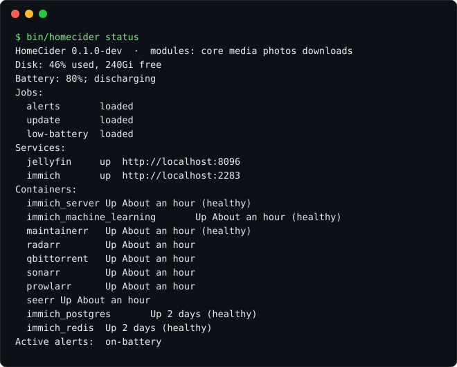

<div align="center">

<h1> HomeCider</h1>

**A self-hosted home server for Apple Silicon.**


HomeCider helps you turn an Apple Silicon Mac into a private home server. It brings together media streaming, photo and video backups, encrypted off-site backups, and system-level security in one automated setup.

It builds on established open-source projects and handles the routine work of keeping your services running and up to date.

[](https://github.com/NipunaRanasinghe/homecider/actions/workflows/shellcheck.yml)
[](LICENSE)


[](CONTRIBUTING.md)

[Quick start](#quick-start) ·
[What you get](#what-you-get) ·
[Install](#install) ·
[Commands](#commands) ·
[How it works](#how-it-works) ·
[Docs](#documentation) ·
[Contributing](#contributing)

</div>

---

## Quick start

```sh
git clone https://github.com/NipunaRanasinghe/homecider.git ~/homecider && cd ~/homecider
bin/homecider init && bin/homecider doctor && bin/homecider apply
```

> [!IMPORTANT]
> `apply` changes settings for the whole Mac and turns off SSH password login.
> Read [Before you install](#before-you-install) first.

> [!NOTE]
> Early development (0.1.0-dev). Tested on a MacBook Air M1 with the current macOS.
> Other Apple Silicon Macs should work; reports are welcome.

## What you get

| | Module | What it does | Default |
|:-:|---|---|---|
| 🛡️ | `core` | Key-only SSH, no sleep (lid closed too), firewall and stealth mode, sharing services off, macOS updates download-only, push alerts (disk, battery, services, updates), weekly app and container updates, clean shutdown on low battery (laptops) | always on |
| 🎬 | `media` | [Jellyfin](https://jellyfin.org) running natively with Apple VideoToolbox hardware transcoding, as a hidden user that can read only your media folder | on |
| 🖼️ | `photos` | [Immich](https://immich.app) photo and video backup from your phone, pinned version | on |
| ☁️ | `backup` | Nightly encrypted [restic](https://restic.net) backup to Backblaze B2 or any S3 bucket, 30-day deletion protection, restore test, alert when stale. See [docs/backup.md](docs/backup.md) | off (needs a bucket) |
| ⬇️ | `downloads` | Request and library management (Seerr, Radarr, Sonarr, Prowlarr, qBittorrent, Maintainerr) with 1080p quality profiles. VPN-only unless you opt in to your home connection. See [docs/downloads.md](docs/downloads.md) | **off** |

HomeCider is designed for use on your home network. It does not configure public internet access or port forwarding, does not use UPnP, and keeps administrative tools bound to localhost. To reach Jellyfin and Immich away from home without exposing them, see [docs/remote-access.md](docs/remote-access.md).

<p align="center">
  <br/>
  <sub>Immich's photo timeline (<code>photos</code> module). Screenshot of Immich's public demo at <a href="https://demo.immich.app">demo.immich.app</a>, not of a HomeCider server.</sub>
</p>

<p align="center">
  <br/>
  <sub>Seerr's Discover page, where people at home request films and shows (<code>downloads</code> module, off by default).</sub>
</p>

### Why macOS and not Linux

- **Hardware transcoding.** Jellyfin uses VideoToolbox on Apple Silicon; Linux on these Macs has no hardware
  video encoder.
- **Battery as a UPS.** On a MacBook, power cuts are covered by the battery, with an alert and a clean shutdown.
- **FileVault.** The whole disk is encrypted when the Mac is off or stolen.

Containers run in [OrbStack](https://orbstack.dev), which uses less memory and CPU than Docker Desktop.
Jellyfin runs outside Docker because containers on macOS cannot use VideoToolbox.

## Before you install

HomeCider is intended for a Mac that stays at home and is available most of the time. A dedicated machine is recommended because HomeCider changes settings across the
whole Mac: it disables sleep (also with the lid closed), turns off File Sharing and Screen Sharing, makes your
home folder private to other accounts, upgrades its own Homebrew apps every week, and on laptops shuts the Mac down
at 15% battery (`BATTERY_SHUTDOWN_PCT`). Every setting and its default is in
[`homecider.env.example`](homecider.env.example).
The full list of system changes is in [What `apply` changes on your Mac](#what-apply-changes-on-your-mac).

> [!WARNING]
> **After a restart or power cut, everything stays down until someone unlocks the Mac in person.** With
> FileVault on (recommended), macOS waits at the unlock screen before any service or SSH starts. Laptops ride
> out short power cuts on battery; desktops restart only when power returns and still need the unlock.

### Requirements

- Apple Silicon Mac (M1 or later), current or previous macOS release: MacBook (lid closed), Mac mini, iMac or
  Mac Studio. Intel Macs are not supported: Apple no longer releases new macOS versions for them, and HomeCider
  is tested only on Apple Silicon.
- [Homebrew](https://brew.sh)
- Remote Login (SSH) on, with your SSH public key in `~/.ssh/authorized_keys`. **`apply` turns off SSH password
  login**, so add the key first.
- FileVault on (recommended).

## Install

Run these commands on the Mac you want to use as your server:

```sh
git clone https://github.com/NipunaRanasinghe/homecider.git ~/homecider
cd ~/homecider
bin/homecider init      # writes ~/.config/homecider/homecider.env; review MODULES and paths
bin/homecider doctor    # checks prerequisites
bin/homecider apply     # sets everything up; asks for your password once for system changes
```

`apply` is designed to be idempotent. You can run it again after changing `homecider.env`, pulling updates with `git pull`, or to reapply a setting.

### First-time checklist

1. Install the [ntfy](https://ntfy.sh) app on your phone and subscribe to the topic `apply` printed.
2. Open Jellyfin at `http://<mac>:8096` and Immich at `http://<mac>:2283` **right away** and create the admin
   accounts. The first visitor becomes admin.
3. Jellyfin: Dashboard → Playback → Transcoding → Hardware acceleration: **Apple VideoToolbox**.
4. Laptops: set a charge limit (System Settings → Battery), so the battery is not held at 100% all the time.

<p align="center">
  <br/>
  <sub>Step 3: Jellyfin's transcoding page with Apple VideoToolbox selected.</sub>
</p>

## Commands

| Command | What it does |
|---|---|
| `bin/homecider init` | Creates `homecider.env` from the example |
| `bin/homecider doctor` | Checks prerequisites and configuration |
| `bin/homecider apply` | Sets up every enabled module (asks for sudo once); safe to re-run |
| `bin/homecider status` | Shows services, jobs, containers, disk, battery and active alerts |
| `bin/homecider backup now \| snapshots \| restore-test` | Runs a backup, lists snapshots, or tests a restore (`backup` module) |
| `bin/homecider vault create \| open \| close \| list` | Manages encrypted disk images for archives |
| `bin/homecider leaktest` | Checks that downloads go through the VPN (`downloads` module) |
| `bin/homecider secret set NAME` | Stores a secret in `secrets.env` without echoing it |
| `bin/homecider uninstall` | Stops services and removes system changes; data is kept |

<p align="center">
  <br/>
  <sub>Output of <code>bin/homecider status</code> on a MacBook Air M1 with <code>core</code>, <code>media</code>, <code>photos</code> and <code>downloads</code> enabled.</sub>
</p>

## Everyday use

### Alerts

Alerts arrive on your phone when:

- the disk is above 85% (`DISK_ALERT_PCT`)
- the Mac runs on battery
- Jellyfin or Immich is down for 10 minutes
- a container stops
- the last backup is more than 36 hours old
- a macOS update is waiting

Alerts go through the public [ntfy.sh](https://ntfy.sh) server: the message text (e.g. "Disk 91% full",
"Jellyfin is down") passes through it, and anyone who knows your topic name can read your alerts. The topic is
random (`hc-` plus 24 hex characters); keep it private, or set `NTFY_SERVER` to your own ntfy server.

### Vaults

For archives you rarely open (old phone backups, documents): `bin/homecider vault create NAME` makes an
AES-256 encrypted disk image in `~/Vault`; while closed it is unreadable, even to programs running as you.
The `backup` module backs vaults up as they are, still encrypted.

### Updates

- HomeCider's Homebrew apps (OrbStack, Jellyfin, restic) and container images update every Sunday at 04:00
  (`UPDATE_WEEKDAY`, `UPDATE_HOUR`). Set `UPDATE_ALL_HOMEBREW=true` to upgrade every Homebrew app.
- After the update, dangling Docker images (untagged, unused) are removed; `UPDATE_PRUNE_IMAGES=false` keeps them.
- Immich is pinned; you get a message when a new release exists.
- macOS updates download automatically and wait for you, because each one restarts into the FileVault unlock
  screen.

## How it works

```mermaid
flowchart TB
    %% =================================================
    %% HOME NETWORK CLIENTS
    %% =================================================
    subgraph CLIENTS["HOME NETWORK · CLIENT DEVICES"]
        direction LR
        PHONE["📱 Phone<br/>Immich App"]
        TV["📺 TV · Laptop · Tablet<br/>Jellyfin"]
        BROWSER["🖥️ Browser<br/>Seerr"]
        ADMIN["🔧 Admin Device<br/>SSH"]
    end

    %% =================================================
    %% APPLE SILICON HOST
    %% =================================================
    subgraph HOST["🍎 APPLE SILICON MAC · macOS HOST"]
        direction TB

        %% HOST SECURITY
        subgraph SECURITY["01 · HOST SECURITY & FOUNDATION"]
            direction LR
            FV["FileVault<br/>Full Disk Encryption"]
            FW["macOS Firewall<br/>Stealth Mode"]
            SSH["SSH<br/>Key-only Authentication"]
            POWER["Power Management<br/>No Sleep · Battery Protection"]
        end

        %% APPLICATIONS
        subgraph APPLICATIONS["02 · APPLICATION & SERVICE LAYER"]
            direction TB

            %% NATIVE SERVICES
            subgraph NATIVE["NATIVE macOS · OUTSIDE CONTAINERS"]
                direction LR
                JF["🎬 Jellyfin<br/>Dedicated Service User"]
                VT["Apple VideoToolbox<br/>Hardware Transcoding"]
                JF ---|"Hardware acceleration"| VT
            end

            %% ORBSTACK
            subgraph ORBSTACK["ORBSTACK · CONTAINER ENVIRONMENT"]
                direction TB

                %% PHOTO SERVICES
                subgraph PHOTOS["🖼️ PHOTO MANAGEMENT"]
                    direction LR
                    IMM["Immich Server"]
                    ML["Machine Learning"]
                    DB["PostgreSQL"]
                    VALKEY["Valkey"]
                    IMM --- ML
                    IMM --- DB
                    IMM --- VALKEY
                end

                %% OPTIONAL DOWNLOAD SERVICES
                subgraph DOWNLOADS["⬇️ DOWNLOAD MANAGEMENT · OPTIONAL / OFF BY DEFAULT"]
                    direction TB
                    SEERR["Seerr<br/>Media Requests"]
                    ARR["Radarr · Sonarr<br/>Prowlarr"]
                    QB["qBittorrent"]
                    VPN["Gluetun VPN<br/>Kill Switch"]
                    MAINT["Maintainerr<br/>Library Cleanup"]

                    SEERR -->|"Requests"| ARR
                    ARR -->|"Download jobs"| QB
                    QB -->|"Network traffic"| VPN
                    MAINT -.->|"Watch history / cleanup"| ARR
                end
            end
        end

        %% STORAGE
        subgraph STORAGE["03 · LOCAL DATA & STORAGE"]
            direction LR
            MEDIA[("🎬 Media Library<br/>~/Media")]
            PHOTO[("🖼️ Photo Library<br/>~/Photos/immich")]
            VAULT[("🔐 Encrypted Vaults<br/>~/Vault")]
        end

        %% HOMECIDER OPERATIONS
        subgraph MANAGEMENT["04 · HOMECIDER · SYSTEM MANAGEMENT"]
            direction TB

            subgraph CORE["CORE · ALWAYS ENABLED"]
                direction LR
                CONFIG["System Configuration<br/>Security · Power"]
                MON["Monitoring<br/>Disk · Battery · Services"]
                ALERT["Push Alerts"]
                UPDATE["Scheduled Updates"]
            end

            subgraph BACKUP["BACKUP · OPTIONAL"]
                RESTIC["Restic<br/>Encrypted Snapshots"]
                RESTORE["Restore Testing<br/>Stale Backup Alerts"]
            end

            CONFIG -.-> MON
            MON --> ALERT
            CONFIG -.-> UPDATE
            RESTIC -.-> RESTORE
        end

        %% INTERNAL DATA FLOWS
        JF -->|"Read-only access"| MEDIA
        IMM -->|"Photo / video storage"| PHOTO
        QB -->|"Downloaded files"| MEDIA
        ARR -->|"Import / hardlinks"| MEDIA

        %% BACKUP SOURCES
        PHOTO -.->|"Backup source"| RESTIC
        VAULT -.->|"Encrypted archive"| RESTIC
        RESTIC -->|"Backup operations"| RESTORE
    end

    %% =================================================
    %% EXTERNAL SERVICES
    %% =================================================
    subgraph EXTERNAL["EXTERNAL SERVICES · INTERNET"]
        direction LR
        INDEXERS["🌐 Indexers"]
        PEERS["Torrent Peers"]
        NTFY["📨 ntfy.sh<br/>Push Notifications"]
        CLOUD["☁️ Backblaze B2 / S3<br/>Backup Destination"]
    end

    %% =================================================
    %% CLIENT ACCESS FLOWS
    %% =================================================
    PHONE -->|"Photo backup · LAN"| IMM
    TV -->|"Media streaming · LAN"| JF
    BROWSER -->|"Media requests · LAN"| SEERR
    ADMIN -->|"Secure administration · SSH"| SSH

    %% =================================================
    %% EXTERNAL NETWORK FLOWS
    %% =================================================
    ARR <-->|"Indexer queries"| INDEXERS
    VPN <-->|"VPN tunnel"| PEERS
    ALERT -->|"Notifications"| NTFY
    RESTIC -->|"Encrypted backup data"| CLOUD

    %% =================================================
    %% SECURITY BOUNDARY NOTES
    %% =================================================
    SECURITY_NOTE["🔒 No public service exposure<br/>No port forwarding · No UPnP<br/>Admin-only tools listen on localhost"]
    VPN_NOTE["🔐 Download traffic is VPN-only<br/>unless home-connection access is explicitly enabled"]

    SECURITY_NOTE -.- SECURITY
    VPN_NOTE -.- VPN

    %% =================================================
    %% STYLING
    %% =================================================
    classDef client fill:#E0F2FE,stroke:#0284C7,color:#0C4A6E
    classDef native fill:#EDE9FE,stroke:#7C3AED,color:#3B0764
    classDef photo fill:#DCFCE7,stroke:#16A34A,color:#14532D
    classDef download fill:#FFEDD5,stroke:#EA580C,color:#7C2D12
    classDef storage fill:#F1F5F9,stroke:#475569,color:#0F172A
    classDef ops fill:#FEF9C3,stroke:#CA8A04,color:#713F12
    classDef external fill:#F8FAFC,stroke:#64748B,color:#334155
    classDef security fill:#FEE2E2,stroke:#DC2626,color:#7F1D1D

    class PHONE,TV,BROWSER,ADMIN client
    class JF,VT native
    class IMM,ML,DB,VALKEY photo
    class SEERR,ARR,QB,VPN,MAINT download
    class MEDIA,PHOTO,VAULT storage
    class CONFIG,MON,ALERT,UPDATE,RESTIC,RESTORE ops
    class INDEXERS,PEERS,NTFY,CLOUD external
    class SECURITY_NOTE,VPN_NOTE security

    style HOST fill:#F8FAFC,stroke:#334155,stroke-width:3px,color:#0F172A
    style CLIENTS fill:#EFF6FF,stroke:#60A5FA,color:#1E3A8A
    style EXTERNAL fill:#F8FAFC,stroke:#94A3B8,stroke-dasharray:5 5,color:#334155
    style NATIVE fill:#F5F3FF,stroke:#A78BFA,color:#4C1D95
    style ORBSTACK fill:#FFF7ED,stroke:#FDBA74,color:#7C2D12
    style STORAGE fill:#F1F5F9,stroke:#94A3B8,color:#0F172A
    style MANAGEMENT fill:#FEFCE8,stroke:#EAB308,color:#713F12
```



🔒 listens on 127.0.0.1 only (SSH tunnel) · 🔐 encrypted disk image, closed when not in use ·
solid arrows: requests and data · dotted arrows: automatic background actions.
Without a VPN configured, qBittorrent sends nothing; the home connection is an explicit opt-in.

### Repository layout

```
bin/homecider          the command
lib/common.sh          config loading, defaults, helpers
modules/<name>/        root.sh (runs with sudo) and/or user.sh, plus the module's files
homecider.env.example  every setting, with defaults
docs/                  design decisions and module guides
tests/                 BATS tests for lib/common.sh (run: bats tests)
```

## What `apply` changes on your Mac

So you can review it before running:

| Area | Change |
|---|---|
| SSH | `/etc/ssh/sshd_config.d/000-homecider.conf`: password and keyboard-interactive login off, root login off, only your user allowed |
| Power | `pmset`: sleep off (also with the lid closed), wake on network |
| Network | Application firewall on with stealth mode; File Sharing, Screen Sharing and Remote Apple Events off |
| Software Update | Automatic check and download; no automatic install |
| launchd | LaunchAgents `io.homecider.alerts` and `io.homecider.update`; on laptops, LaunchDaemon `io.homecider.low-battery` |
| `media` | Hidden user `_jellyfin` (UID 450), LaunchDaemon `io.homecider.jellyfin`, data in `/Library/Application Support/jellyfin`, a sudoers rule that lets you restart Jellyfin without a password. Your home folder becomes `750` and other home folders readable by other users become private |
| `photos` or `downloads` | A `PATH` line for OrbStack's `docker` in `~/.zshenv`, the compose and buildx plugins linked into `~/.docker/cli-plugins/`, OrbStack set to start at login with a memory cap (`DOCKER_MEMORY_MIB`) |
| Files | Your settings in `~/.config/homecider/homecider.env`. Secrets (ntfy topic, database and app passwords) in `~/Library/Application Support/homecider/secrets.env` (mode 600), generated Compose settings in `~/Library/Application Support/homecider/compose/`. Nothing is written into the code folder |

## Uninstall

```sh
bin/homecider uninstall
```

Stops the containers, removes the launchd jobs, the SSH config file, the sudoers rule and the `_jellyfin` user,
and resets `pmset` to the macOS defaults (sleep on). SSH password login is allowed again.

- **Kept**: media, photos, app data, Jellyfin data, vaults, `homecider.env`, `secrets.env`, the backup repository
  and the Homebrew apps (`brew uninstall --cask orbstack jellyfin` removes them).
- **Not changed back**: firewall and stealth mode, sharing services (off), the macOS update policy and
  home-folder permissions. HomeCider does not record their values before `apply`; change them in System Settings.

## Documentation

| Document | Contents |
|---|---|
| [docs/DESIGN.md](docs/DESIGN.md) | Design decisions |
| [docs/backup.md](docs/backup.md) | Setting up and restoring the `backup` module |
| [docs/downloads.md](docs/downloads.md) | Setting up the `downloads` module and its VPN |
| [docs/remote-access.md](docs/remote-access.md) | Reaching Jellyfin and Immich away from home with Tailscale |
| [homecider.env.example](homecider.env.example) | Every setting, with defaults |

## Contributing

Contributions are welcome. If you find a bug or have an improvement, please open an issue or submit a focused pull request. See [CONTRIBUTING.md](CONTRIBUTING.md) for issue details and testing guidance.

For security vulnerabilities, use GitHub's private vulnerability reporting rather than opening a public issue.

## Third-party components

HomeCider installs and configures software maintained by other projects. Each component remains subject to its own license.
`modules/photos/docker-compose.yml` and `example.env` are Immich's official files (AGPL-3.0), unmodified.
Container images belong to their projects (Immich, LinuxServer.io, Seerr, Maintainerr, Recyclarr).
Quality profiles come from [TRaSH Guides](https://trash-guides.info) via Recyclarr.

## License

[MIT](LICENSE)
